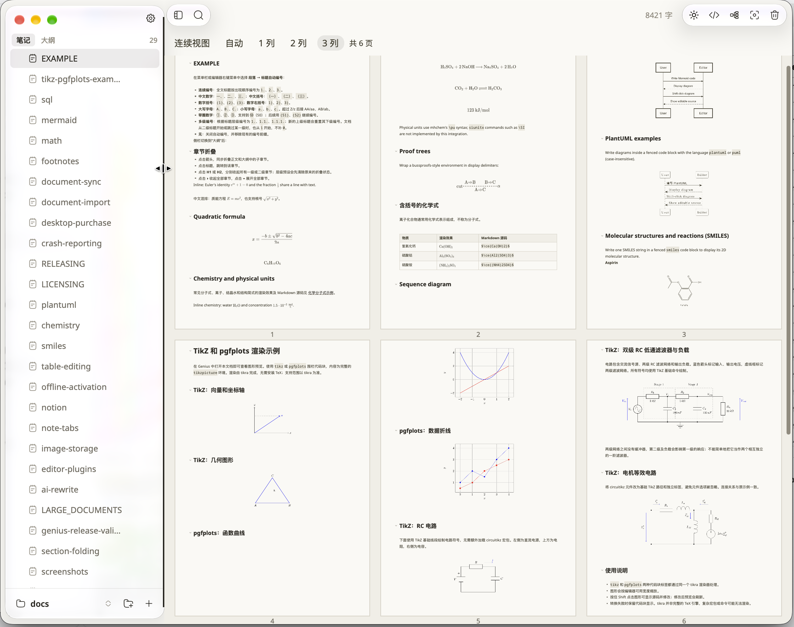
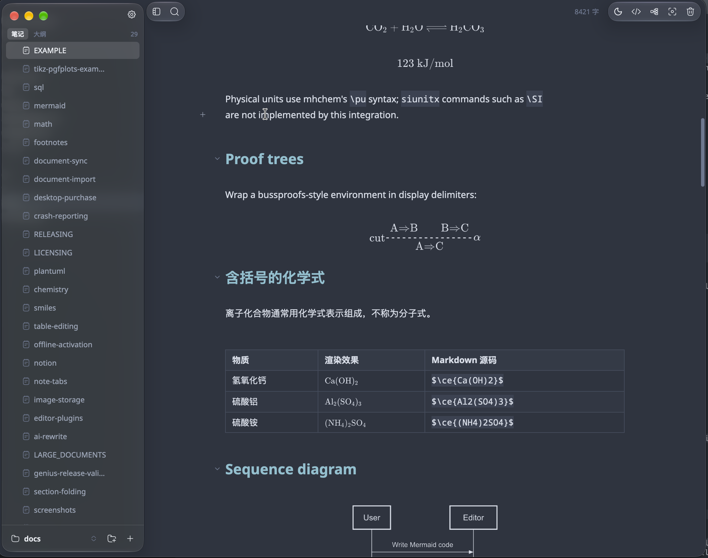
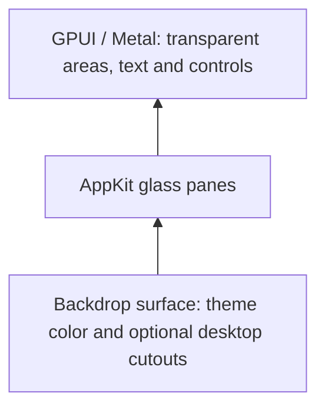

# GPUI Liquid Glass

[简体中文](README.zh-CN.md)

A skill for **Codex and Claude Code** that implements, repairs, and analyzes Apple's native Liquid Glass in Rust GPUI and GPUI Kit desktop applications. It guides the agent through AppKit material selection, transparent window composition, layout synchronization, and older macOS fallbacks.

The package contains agent instructions and a native API example. The bundled skill instructions are in Chinese; the usage examples are available in English and Chinese.

## Preview

These screenshots show the Liquid Glass implementation in the **Genius Markdown editor**, including its glass sidebar and toolbar capsules.

| Light appearance | Dark appearance |
| --- | --- |
|  |  |

Visit the [official Genius website](https://gns.sh) to download the app and experience the effect in use.

## What it covers

- `NSGlassEffectView` and `NSGlassEffectContainerView` on macOS 26+.
- `NSVisualEffectView` as a traditional material fallback.
- Glass sidebars, toolbar capsules, floating controls, and their GPUI interaction states.
- Background sources, native view ownership, clipping, animation, zoom, and window cleanup.
- Runtime class availability, including safe updates on older systems.
- Real-window checks for background sampling, themes, accessibility settings, and geometry.

For a backend that paints the window into one Metal surface, the composition can be:



The glass samples content behind its native view. To refract scrolling editor content, that content must actually be behind the glass; putting a material below the entire GPUI surface does not provide that background.

| Platform | Material path |
| --- | --- |
| macOS 26+ | Native Liquid Glass |
| Older macOS | Traditional vibrancy fallback, when supported |
| Windows / Linux | Existing opaque presentation |

## Install

### With the installation script

Requires Bash and Python 3.9+. The download entry point also uses `curl`.

```bash
# Codex (default):
curl -fsSL https://raw.githubusercontent.com/sxhxliang/gpui-liquid-glass/main/install.sh | bash

# Claude Code:
curl -fsSL https://raw.githubusercontent.com/sxhxliang/gpui-liquid-glass/main/install.sh | bash -s -- --agent claude

# Both agents:
curl -fsSL https://raw.githubusercontent.com/sxhxliang/gpui-liquid-glass/main/install.sh | bash -s -- --agent both
```

| Agent | Personal installation | Project installation | Invocation |
| --- | --- | --- | --- |
| Codex | `~/.agents/skills/gpui-liquid-glass` | `.agents/skills/gpui-liquid-glass` | `$gpui-liquid-glass` |
| Claude Code | `~/.claude/skills/gpui-liquid-glass` | `.claude/skills/gpui-liquid-glass` | `/gpui-liquid-glass` |

An explicit `CODEX_HOME` changes the Codex personal destination to `$CODEX_HOME/skills/gpui-liquid-glass`. It does not affect Claude Code. See the [OpenAI skills documentation](https://learn.chatgpt.com/docs/build-skills) and [Claude Code skills documentation](https://code.claude.com/docs/en/skills) for discovery and invocation details.

For a checkout or a custom directory:

```bash
git clone https://github.com/sxhxliang/gpui-liquid-glass.git
cd gpui-liquid-glass
bash install.sh

# Install for Claude Code in a GPUI project:
bash install.sh --agent claude --project /path/to/app

# Alternatively, install for both agents in a fresh project:
bash install.sh --agent both --project /path/to/app

# Compatibility with installations using ~/.codex/skills:
bash install.sh --skills-dir "$HOME/.codex/skills"
```

Use `--skills-dir PATH` to choose a custom directory for one agent. With `--agent both`, use the personal defaults or `--project PATH`.

The installer copies the same `SKILL.md` and resources for either agent. Existing installations are preserved unless `--force` is supplied. Updates save the previous directory under `skill-backups` next to the selected skills directory.

To add the other agent to a project that already has this skill, run `--agent both --project /path/to/app --force`.

```bash
# Update from GitHub; --ref selects a branch, tag, or commit for the skill content:
python3 scripts/install.py --agent both --ref main --force

# Install from a local skill directory without downloading:
python3 scripts/install.py --agent claude --source ./skills/gpui-liquid-glass

python3 scripts/install.py --help
```

If the skill does not appear, restart Codex or start a new Claude Code session in the target project.

### From Codex

Ask Codex:

```text
$skill-installer install the skill from https://github.com/sxhxliang/gpui-liquid-glass/tree/main/skills/gpui-liquid-glass
```

## Use

Open a GPUI project and invoke the skill in your prompt.

In Codex:

```text
$gpui-liquid-glass Add a native Liquid Glass sidebar to this GPUI application.
Use the desktop as its background, follow the existing theme and zoom rules,
and verify the macOS fallback and layout synchronization.
```

In Claude Code:

```text
/gpui-liquid-glass Add a native Liquid Glass sidebar to this GPUI application.
Use the desktop as its background, follow the existing theme and zoom rules,
and verify the macOS fallback and layout synchronization.
```

In the ChatGPT desktop skill picker, use `@` to select the skill. In Codex CLI or the IDE extension, use `$gpui-liquid-glass` or `/skills`.

[Usage examples](examples/usage.md) work in both agents and include toolbar capsules, older-system repairs, read-only analysis, and application-content sampling. The [native bridge reference](skills/gpui-liquid-glass/references/macos-bridge.md) includes the Rust example and Cargo features; [verification guidance](skills/gpui-liquid-glass/references/verification.md) covers real-window validation.

## Development

```bash
python3 -B -m unittest discover -s tests -v
bash -n install.sh
```

The installer tests use temporary directories and in-memory GitHub archives. They cover Codex and Claude Code destinations, project installation, updates, backups, rollback, custom paths, environment overrides, archive extraction, a verified `curl` fallback for missing Python certificate roots, and failure handling. The native API example was compiled with Rust 1.98.1, `objc2 0.6.5`, and `objc2-app-kit 0.3.2`; that check does not establish a particular app's rendered appearance.

## Contents

```text
skills/gpui-liquid-glass/   Installable skill and references
examples/                  English and Chinese usage prompts
assets/                    Light and dark appearance screenshots
scripts/install.py         Standalone Python installer
install.sh                 Shell entry point
tests/test_install.py      Installer regression tests
```
