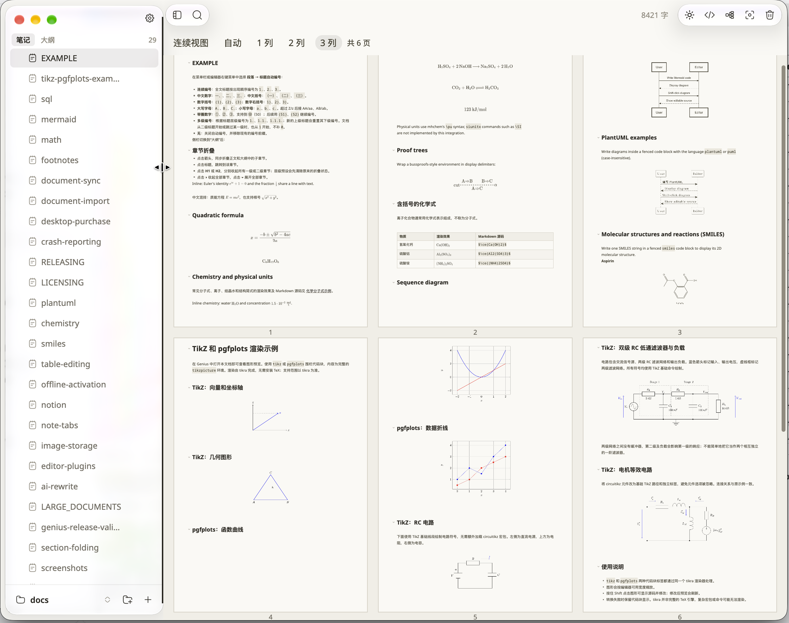
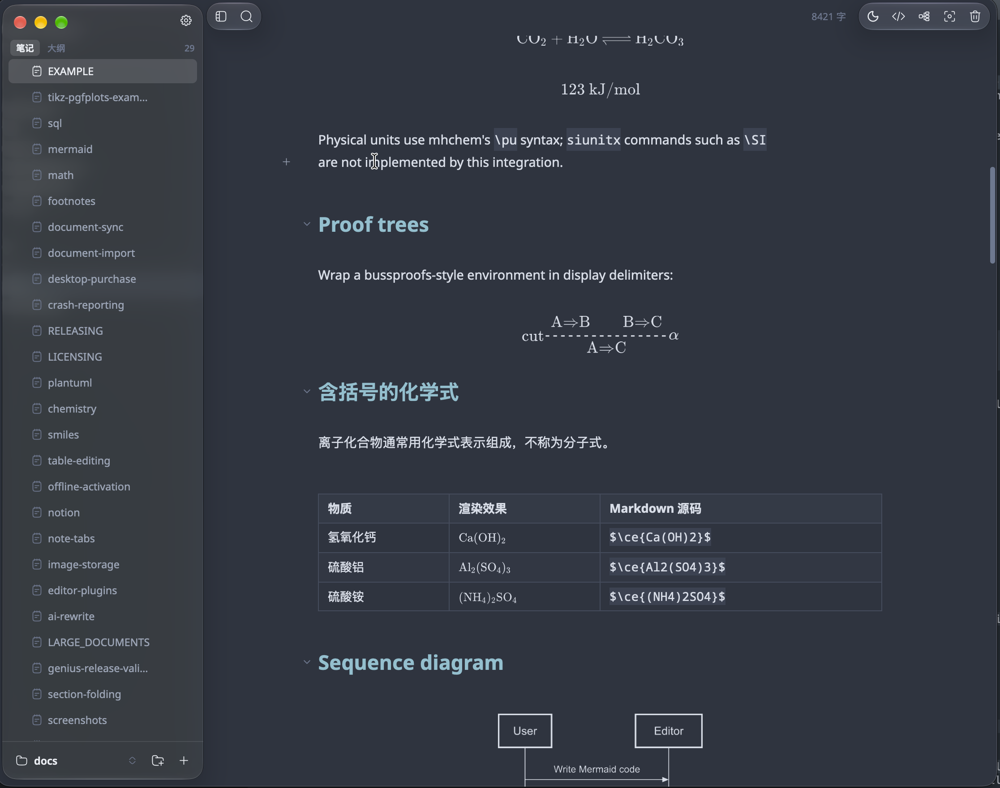
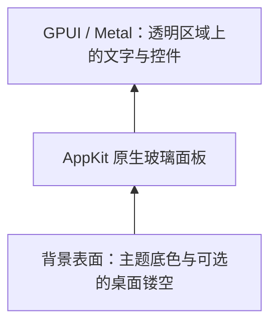

# GPUI Liquid Glass

[English](README.md)

支持 **Codex 和 Claude Code**，用于在 Rust GPUI / GPUI Kit 桌面应用中实现、修复和分析 Apple 原生 Liquid Glass。它指导智能体选择 AppKit 材质、安排透明窗口和背景合成、同步布局，并处理旧版 macOS 降级。

仓库包含智能体指令和原生 API 示例。skill 正文使用中文，使用示例提供中英文版本。

## 效果展示

以下截图展示了 **Genius Markdown 编辑器** 中 Liquid Glass 的实践效果，包括玻璃侧栏与工具栏胶囊。

| 浅色界面 | 深色界面 |
| --- | --- |
|  |  |

欢迎前往 [Genius 官网](https://gns.sh) 下载应用，体验实际效果。

## 覆盖内容

- macOS 26+ 的 `NSGlassEffectView` 和 `NSGlassEffectContainerView`。
- 使用 `NSVisualEffectView` 提供传统材质降级。
- 玻璃侧栏、工具栏胶囊、浮动控件，以及 GPUI 的交互状态。
- 背景来源、原生视图生命周期、裁剪、动画、缩放和窗口清理。
- 运行时类可用性，包括旧系统上的类型安全更新。
- 背景取样、主题、系统辅助设置和几何对齐的真实窗口验证。

对于整窗绘制在一个 Metal 表面中的后端，可采用下面的合成结构：



玻璃采样的是原生视图后方的内容。需要折射滚动正文时，正文必须真正处于玻璃后方；把材质放在整个 GPUI 表面下面，无法直接取样这个表面绘制的正文。

| 平台 | 材质路径 |
| --- | --- |
| macOS 26+ | 原生 Liquid Glass |
| 较早 macOS | 在支持时降级为传统 vibrancy |
| Windows / Linux | 应用原有的不透明界面 |

## 安装

### 使用安装脚本

需要 Bash 和 Python 3.9+，下载入口还需要 `curl`。

```bash
# Codex（默认）：
curl -fsSL https://raw.githubusercontent.com/sxhxliang/gpui-liquid-glass/main/install.sh | bash

# Claude Code：
curl -fsSL https://raw.githubusercontent.com/sxhxliang/gpui-liquid-glass/main/install.sh | bash -s -- --agent claude

# 同时安装到两个智能体：
curl -fsSL https://raw.githubusercontent.com/sxhxliang/gpui-liquid-glass/main/install.sh | bash -s -- --agent both
```

| 智能体 | 个人安装位置 | 项目安装位置 | 调用方式 |
| --- | --- | --- | --- |
| Codex | `~/.agents/skills/gpui-liquid-glass` | `.agents/skills/gpui-liquid-glass` | `$gpui-liquid-glass` |
| Claude Code | `~/.claude/skills/gpui-liquid-glass` | `.claude/skills/gpui-liquid-glass` | `/gpui-liquid-glass` |

设置了 `CODEX_HOME` 时，Codex 的个人安装位置改为 `$CODEX_HOME/skills/gpui-liquid-glass`，Claude Code 不受影响。加载和调用方式见 [OpenAI 官方 skills 文档](https://learn.chatgpt.com/docs/build-skills)与 [Claude Code 官方 skills 文档](https://code.claude.com/docs/en/skills)。

从本地仓库安装，或指定安装目录：

```bash
git clone https://github.com/sxhxliang/gpui-liquid-glass.git
cd gpui-liquid-glass
bash install.sh

# 为 GPUI 项目安装 Claude Code skill：
bash install.sh --agent claude --project /path/to/app

# 或者为尚未安装该 skill 的项目同时安装两个智能体：
bash install.sh --agent both --project /path/to/app

# 兼容使用 ~/.codex/skills 的安装：
bash install.sh --skills-dir "$HOME/.codex/skills"
```

使用 `--skills-dir PATH` 可为单个智能体指定自定义目录。选择 `--agent both` 时，使用个人默认位置或 `--project PATH`。

两个智能体使用相同的 `SKILL.md` 与参考资源。已有安装需要显式使用 `--force` 才会更新；旧版本保存在所选 skills 目录旁的 `skill-backups` 目录中。

项目已安装该 skill，需要再支持另一个智能体时，使用 `--agent both --project /path/to/app --force`。

```bash
# 从 GitHub 更新；--ref 可选择 skill 内容的分支、标签或提交：
python3 scripts/install.py --agent both --ref main --force

# 从本地 skill 目录安装，无需下载：
python3 scripts/install.py --agent claude --source ./skills/gpui-liquid-glass

python3 scripts/install.py --help
```

如果 skill 没有出现，重启 Codex，或在目标项目中开启新的 Claude Code 会话。

### 通过 Codex 安装

向 Codex 输入：

```text
$skill-installer 从 https://github.com/sxhxliang/gpui-liquid-glass/tree/main/skills/gpui-liquid-glass 安装这个 skill
```

## 使用

打开 GPUI 项目，并在提示中调用 skill。

Codex：

```text
$gpui-liquid-glass 给当前 GPUI 应用添加原生 Liquid Glass 侧栏。
侧栏取样桌面背景，遵循现有主题和缩放规则，验证旧版 macOS 降级及布局同步。
```

Claude Code：

```text
/gpui-liquid-glass 给当前 GPUI 应用添加原生 Liquid Glass 侧栏。
侧栏取样桌面背景，遵循现有主题和缩放规则，验证旧版 macOS 降级及布局同步。
```

在 ChatGPT 桌面端的技能选择器中使用 `@`；在 Codex CLI 或 IDE 扩展中使用 `$gpui-liquid-glass` 或 `/skills`。

[使用示例](examples/usage.zh-CN.md)适用于两个智能体，覆盖工具栏胶囊、旧系统问题修复、只读分析和正文取样。[原生桥接参考](skills/gpui-liquid-glass/references/macos-bridge.md)包含 Rust 示例和 Cargo features；[验证指南](skills/gpui-liquid-glass/references/verification.md)说明如何在真实窗口中验证效果。

## 开发验证

```bash
python3 -B -m unittest discover -s tests -v
bash -n install.sh
```

安装器测试使用临时目录和内存中的 GitHub ZIP 内容，覆盖 Codex 与 Claude Code 的安装位置、项目安装、更新、备份、失败恢复、自定义路径、环境变量、解压、Python 缺少根证书时保留 HTTPS 验证的 `curl` 下载降级，以及错误处理。原生 API 示例已在 Rust 1.98.1、`objc2 0.6.5`、`objc2-app-kit 0.3.2` 下编译；该检查不能替代具体应用的视觉验证。

## 仓库内容

```text
skills/gpui-liquid-glass/   可安装的 skill 与参考文档
examples/                  中英文使用提示
assets/                    浅色和深色界面截图
scripts/install.py         独立 Python 安装器
install.sh                 Shell 安装入口
tests/test_install.py      安装器回归测试
```
